# Project Phasing Plan — Delhi NCR Coupled AQI Forecasting System
### 72-Hour High-Resolution AQI Forecasting (CAMS + ML-Hybrid → WRF-Chem Ready)

> **Sprint Mode: 3 Days Only.** How to pull off the full project in 72 hours. Each phase is time-boxed in hours, not weeks, with parallel tracks and pre-built fallbacks so the demo is delivery-ready on Day 3.

---

## Table of Contents
- [Phasing Philosophy (3-Day Sprint)](#phasing-philosophy-3-day-sprint)
- [Timeline at a Glance — 3 Days](#timeline-at-a-glance--3-days)
- [Phase 1: Foundation (Day 1 — Hours 0–4)](#phase-1-foundation-day-1--hours-04)
- [Phase 2: Data Pipeline (Day 1 — Hours 4–14)](#phase-2-data-pipeline-day-1--hours-414)
- [Phase 3: ML-Hybrid Engine (Day 2 — Hours 14–24)](#phase-3-ml-hybrid-engine-day-2--hours-1424)
- [Phase 4: Post-Processing & Metrics (Day 2 — Hours 24–32)](#phase-4-post-processing--metrics-day-2--hours-2432)
- [Phase 5: Backend & Real-Time Dashboard (Day 2–3 — Hours 32–64)](#phase-5-backend--real-time-dashboard-day-23--hours-3264)
- [Phase 6: Production & WRF-Chem Hardening (Day 3 — Hours 64–72)](#phase-6-production--wrf-chem-hardening-day-3--hours-6472)
- [How to Execute: Pulling Off the Phases in 3 Days](#how-to-execute-pulling-off-the-phases-in-3-days)
- [Dependencies & Critical Path](#dependencies--critical-path)
- [Milestones & Demo Checklist](#milestones--demo-checklist)
- [Team & Resource Split](#team--resource-split)
- [Risks by Phase](#risks-by-phase)

---

## Phasing Philosophy (3-Day Sprint)

1. **Ship CAMS + ML first, WRF-Chem later:** CAMS gives real physics on Hour 1; WRF-Chem is a drop-in replacement in Phase 6 with zero dashboard/DB/ML rework. Do NOT attempt WRF-Chem compile in 3 days — mock it.
2. **Vertical slices, not layers:** Each phase ends with a runnable artifact (config → parquet → model → AQI JSON → dashboard URL) not just code.
3. **Parallel tracks > sequential:** With 3 days, 3–4 people work in parallel on Day 1 (fetchers), Day 2 (ML + metrics + backend scaffold together).
4. **Mock before real:** If any API is slow, use cached sample CSV/NetCDF committed in `data/samples/` so downstream phases never block.
5. **No phase without verification:** Every phase has a 5-minute gate script (`validate_apis.py`, `features.parquet` check, RMSE, pytest, `localhost:3000`).

---

## Timeline at a Glance — 3 Days

| Phase | Title | Time Box | Wall Clock | Key Deliverable |
|-------|-------|----------|------------|-----------------|
| **1** | **Foundation** | 4 hours | **Day 1: 00:00–04:00** | Repo + config + storage + 4 API keys GREEN (or mocked) |
| **2** | **Data Pipeline** | 10 hours | **Day 1: 04:00–14:00** | `data/fetch_*.py` + `features.parquet` for Delhi NCR |
| **3** | **ML-Hybrid Engine** | 10 hours | **Day 2: 14:00–24:00** | XGBoost per-station + `forecast_corrected.csv` + RMSE vs CAMS |
| **4** | **Post-Processing & Metrics** | 8 hours | **Day 2: 24:00–32:00** | `aqi.py` + `metrics.py` (AQI, inversion ΔT, VC, plume GeoJSON) |
| **5** | **Backend & Dashboard** | 32 hours* | **Day 2: 32:00 → Day 3: 64:00** | FastAPI + React/Leaflet live dashboard (72h traces, maps, alerts) |
| **6** | **Production & Hardening** | 8 hours | **Day 3: 64:00–72:00** | Docker, deploy, polish, demo video, `PHYSICS_SOURCE=cams\|wrfchem` toggle |

> **\*Phase 5 starts early on Day 2 in parallel** — backend scaffold begins at Hour 20, frontend at Hour 28, so Phase 4 and 5 overlap. Total = **72 hours**.
> No HPC needed. Laptop/small server only.

```mermaid
gantt
    title 3-Day Sprint — Delhi AQI
    dateFormat HH
    axisFormat %Hh
    Phase 1 Foundation (4h)      :p1, 00, 4h
    Phase 2 Data Pipeline (10h)  :p2, after p1, 10h
    Phase 3 ML-Hybrid (10h)      :p3, after p2, 10h
    Phase 4 Metrics (8h)         :p4, after p3, 8h
    Phase 5 Backend+Dash (32h)   :p5, 20, 44h
    Phase 6 Production (8h)      :p6, 64, 8h
```



**Hourly Sprint View:**
```
Day 1 (Hours 0-24)   : [ P1 4h ][      P2 10h      ][  P3 starts 10h       ]
Day 2 (Hours 24-48)  : [  P3 tail ][ P4 8h ][      P5 Backend+Frontend         ]
Day 3 (Hours 48-72)  : [         P5 tail (polish)          ][  P6 8h  ][ DEMO ]
```

---

## Phase 1: Foundation (Day 1 — Hours 0–4)

**Goal:** Make the project runnable by anyone in <10 minutes; lock contracts so no later phase rewrites.

### Objectives
- Repo clones and runs; all API access proven (or mocked) by Hour 4.

### Tasks (4h, parallelize)
1.  **Repo & Structure (30 min)**
    ```bash
    delhi-wrfchem-aqi/
    ├── config/          # stations.yaml, domain.yaml, settings.py
    ├── data/
    │   ├── raw/ & processed/ & samples/  # commit samples/ for offline fallback
    ├── ml/
    ├── postprocess/
    ├── backend/
    ├── frontend/
    ├── scripts/
    └── docs/
    ```
2.  **Config Contracts (60 min)**
    - `config/stations.yaml` — 10–15 key CPCB stations (not 40 — cut scope) e.g., Anand Vihar, RK Puram, ITO, Dwarka
    - `config/domain.yaml` — Delhi NCR bbox [28.3–28.9, 76.8–77.5], map center 28.61, 77.23
    - `config/settings.py` — `python-dotenv`, `.env.example` with `CAMS_ADS_KEY`, `FIRMS_MAP_KEY`
3.  **Environment (60 min)**
    - `requirements.txt` — pin: pandas, xarray, numpy, xgboost, scikit-learn, fastapi, uvicorn, requests
    - `Dockerfile` + `docker-compose.yml` optional — don’t block on this in 3 days, keep it simple
4.  **Storage (30 min)**
    - MVP: SQLite + Parquet only. Skip Postgres/Redis for sprint — add later in Phase 6.
    - Schema: `(station_id, timestamp)` PK, Parquet partitioned by date.
5.  **API Key Validation (60 min, critical)**
    - `scripts/validate_apis.py` — hits CAMS ADS, CPCB, Open-Meteo, FIRMS with one Delhi query.
    - **If CAMS approval pending (common, 24h delay):** immediately commit `data/samples/cams_sample.nc` + `cpcb_sample.csv` and set `USE_MOCK=true`.

### Deliverables (Hour 4 gate)
- [ ] `pip install -r requirements.txt` works
- [ ] `python scripts/validate_apis.py` → 4× PASS or 4× MOCK PASS
- [ ] `.env.example` committed, `stations.yaml` with 10 stations

### Exit Criteria
New teammate clones, `cp .env.example .env`, runs `validate_apis.py` — green in <10 min.

### Sprint Tip
Apply for CAMS ADS key **before Hour 0** if possible. If not, don’t wait — mock is the plan.

---

## Phase 2: Data Pipeline (Day 1 — Hours 4–14)

**Goal:** One clean `features.parquet` that ML can ingest directly.

### Objectives
- 4 fetchers done in parallel; hardest join (CAMS 40km grid → station point) solved.

### Tasks (10h, 4 people in parallel)

| Module | File | Input → Output | Hour | Key Logic (sprint-cut) |
|--------|------|----------------|------|------------------------|
| CAMS Fetch | `data/fetch_cams.py` | CAMS ADS → `data/raw/cams.nc` or `samples/cams_sample.nc` | 4–8 | Query Delhi bbox, variables pm2p5/pm10/o3/no2, save NetCDF. **Cut:** single time slice, not 5-day historical scrape |
| CPCB Fetch | `data/fetch_cpcb.py` | CPCB/CCR → `data/raw/cpcb.csv` | 4–8 | Poll hourly, 10 stations only. **Cut:** scrape 7 days history, not 1 year |
| Met Fetch | `data/fetch_met.py` | Open-Meteo → `data/raw/met.csv` | 4–7 | Hourly temp/humidity/wind. One call per station. |
| Fire Fetch | `data/fetch_fires.py` | FIRMS VIIRS → `data/raw/firms.csv` | 4–6 | Punjab+Haryana+Delhi bbox, FRP. Smallest task — do first. |
| Feature Builder | `ml/features.py` | 4 raws → `data/processed/features.parquet` | 8–14 | Align (nearest-neighbor, not bilinear — faster) + lags (-6/-12/-24h) + derive (inversion proxy, VC, fire count/dist) + time (hod, doy) |

### Feature Matrix Schema (sprint scope, per row = station × hour)
```
station_id | timestamp | cams_pm25 | temp | wind_spd | obs_pm25_lag6 | obs_pm25_lag24 |
fire_count_100km | fire_dist_nearest | hod | target_obs_pm25 (+24h, +48h, +72h only)
```
*Cut from 7 leads to 3 leads (24/48/72h) for speed.*

### Deliverables (Hour 14 gate)
- [ ] 4 fetcher scripts with retries
- [ ] `features.parquet` with ≥7 days × 10 stations = ~1680 rows, 0 critical NaNs
- [ ] Quick `notebooks/eda.ipynb` or just `python ml/features.py --check` prints CAMS–CPCB corr

### Exit Criteria
`python ml/features.py --date today` → parquet exists, corr >0.5.

### Sprint Tip
Feature builder owner defines parquet schema at Hour 4 sharp, so fetchers can emit mock CSVs immediately.

---

## Phase 3: ML-Hybrid Engine (Day 2 — Hours 14–24)

**Goal:** Correct CAMS bias per station, prove skill vs raw CAMS, show widening uncertainty.

### Objectives
- XGBoost only (no LSTM in 3 days). 3 lead times only.

### Approach (sprint-cut)
- **One XGBoost per station × lead (24/48/72h)** — 10 stations × 3 leads = 30 tiny models, ~1 min each.
- **Target:** `obs_pm25(t+H)` , H=24,48,72
- **Features:** 8–10 columns from Phase 2 at time `t`
- **Split:** 5 days train / 2 days val (not months — we only have 7 days).

### Tasks (10h)
1.  **Train (Hours 14–20) — `ml/train.py`**
    - XGBoost with default params (no Optuna in sprint — use `n_estimators=100, max_depth=5`)
    - Log RMSE to console, skip MLflow for speed (just CSV)
2.  **Uncertainty (Hours 20–22) — `ml/infer.py`**
    - Ensemble of 3 seeds → mean + std → p10/p90 band (fastest to code). Skip quantile regression.
3.  **Infer (Hours 22–24)**
    - `ml/infer.py` → `data/processed/forecast_corrected.csv` (10 stations × 72h)
4.  **Verify (Hour 24)**
    - Print table: `RMSE_cams vs RMSE_corrected @24/48/72h`

### Deliverables (Hour 24 gate)
- [ ] `models/xgb_station_*.pkl` (30 files)
- [ ] `forecast_corrected.csv` (72 rows per station)
- [ ] Console report: `RMSE corrected < RMSE cams` at 24h (even 5% win counts for demo)

### Exit Criteria
Corrected beats raw CAMS at 24h, and p90–p10 width at 72h > width at 24h.

### Sprint Cut
If training slips: use **hard-coded bias correction** (`corrected = 0.8*cams + 0.2*lag24`) as fallback — still demoable as “ML-hybrid”.

---

## Phase 4: Post-Processing & Metrics (Day 2 — Hours 24–32)

**Goal:** Concentrations → AQI + physics diagnostics the dashboard can render.

### Tasks (8h, can overlap with Phase 3 tail)

| Module | File | Logic | Hour |
|--------|------|-------|------|
| AQI | `postprocess/aqi.py` | Indian CPCB breakpoints → max sub-index = AQI + category/color | 24–26 |
| Inversion | `postprocess/metrics.py::inversion_strength()` | `T_925hPa - T_surface` proxy; positive = trapping | 26–28 |
| Ventilation | `postprocess/metrics.py::ventilation_coeff()` | `VC = PBL_proxy × wind_spd`; <2000 = episode | 28–29 |
| Plume | `postprocess/metrics.py::plume_path()` | FIRMS hotspots advected by wind 72h (Lagrangian, simple) → GeoJSON | 29–31 |
| Verification | `postprocess/metrics.py::verification()` | RMSE/MAE JSON for dashboard | 31–32 |

### Deliverables (Hour 32 gate)
- [ ] `aqi.py` tested: PM2.5=150 → AQI 180
- [ ] `metrics.py` → `data/processed/metrics.json` (inversion, VC, plume GeoJSON)
- [ ] `pytest postprocess/ -q` passes (5 tests)

### Exit Criteria
Sample `metrics.json` renders in Leaflet preview HTML (even static file) before backend exists.

---

## Phase 5: Backend & Real-Time Dashboard (Day 2–3 — Hours 32–64)

**Goal:** Live product the judge/user opens.

### Backend — `backend/` (Hours 32–44, 12h)

| Component | File | Endpoints (sprint-cut: 4 only) |
|-----------|------|-------------------------------|
| FastAPI | `backend/api/main.py` | `GET /api/forecast?station=&hours=72` (corrected + bands)<br>`GET /api/observations?station=`<br>`GET /api/metrics?station=` (inversion/VC/plume)<br>`GET /api/verification` |
| Scheduler | `backend/services/scheduler.py` | **Cut for sprint:** manual `POST /api/refresh` trigger, not Celery. Auto every 6h is Phase 6. |
| Storage | `backend/services/storage.py` | Read Parquet/CSV directly; no DB for sprint (add SQLite later if time) |
| Notify | — | **Cut:** alerts = frontend banner when AQI>300, no email/push |

### Frontend — `frontend/` (Hours 36–64, 28h overlapping)

| View | Library | Hour | Sprint Note |
|------|---------|------|-------------|
| Scaffold | Vite + React + TS + Tailwind | 36–38 | `npm create vite@latest` |
| 72-h Trace | Plotly or ECharts | 38–46 | Core demo — do first. Line + band, toggle CAMS vs corrected |
| Contour Map | Leaflet + GeoJSON | 46–52 | Interpolate 10 stations → colored dots/contours |
| Inversion Gauge | ECharts gauge | 52–55 | Simple gauge |
| Plume Animation | Leaflet | 55–60 | FIRMS dots + 72h path with slider. **If short: static dots + wind arrow** |
| Verification | Table | 60–62 | RMSE table |
| Polish | — | 62–64 | Responsive, loading states, health advisory banner |

### Tasks
1.  Hour 32–36: Scaffold backend, `uvicorn` hello + CORS
2.  Hour 36–46: Trace panel (hardest) — finish first
3.  Hour 46–64: Maps, gauge, plume, table in parallel if 2 frontend devs
4.  Hour 64: `API at :8000/docs` + `Dashboard at :3000` both live

### Deliverables (Hour 64 gate)
- [ ] `uvicorn backend.api.main:app --reload` → Swagger at `:8000/docs`
- [ ] `npm run dev` → dashboard at `:3000` with 72h forecast + maps
- [ ] Demo video (2 min) ready

### Exit Criteria
Non-technical user picks Anand Vihar, sees 72h AQI + band + inversion/VC/plume without help.

---

## Phase 6: Production & WRF-Chem Hardening (Day 3 — Hours 64–72)

**Goal:** Make the 3-day sprint look production-grade for SIH judges.

### Tasks (8h)

**6A — Hardening (Hours 64–70, 6h)**
- Docker: `Dockerfile` + `docker-compose up` (api + frontend)
- Add SQLite if not done (copy `forecast_corrected.csv` into `forecast.db`)
- GitHub Actions CI stub (lint + pytest)
- `docs/deployment.md` (how to run on any VPS)
- Polish: loading spinners, error banners, `healthz` endpoint
- **WRF-Chem mock:** add `PHYSICS_SOURCE=cams|wrfchem` env toggle — both read same Parquet but label changes to “WRF-Chem (mock)”. Full WRF-Chem compile is **explicitly out of scope for 3 days** (needs Linux/HPC, 10h+). Document upgrade path in README.

**6B — Demo Prep (Hours 70–72, 2h)**
- Record Loom: 72h trace, contour map, inversion gauge, plume, verification
- Freeze `main` branch, tag `v0.3-sprint`
- Prepare 5-slide deck: Problem → CAMS+ML diagram → RMSE win → Dashboard screenshot → WRF-Chem path

### Deliverables (Hour 72 gate)
- [ ] `docker-compose up` works on fresh clone
- [ ] Production toggle: `PHYSICS_SOURCE=wrfchem` shows “WRF-Chem (simulated)” without code change
- [ ] Tag `v0.3-sprint` + demo video + slides

### Exit Criteria
Judge can `git clone && docker-compose up` and see live dashboard in <5 min, plus a clear “Phase 6: Real WRF-Chem = swap fetcher, same API” story.

---

## How to Execute: Pulling Off the Phases in 3 Days

### 1. Hour-by-Hour Sprint Board (for 4–6 person team)

```
Day 1  00h ━━━ P1 Foundation (4h) ━━━┓
       04h ━━━ P2 Fetchers (parallel 4 people, 4h) ━━━┓
       08h ━━━ P2 Feature Builder (6h) ━━━┓
       14h ━━━ P3 ML Train (6h) ━━━┓
Day 2  20h ━━━ P3 Infer + Uncertainty (4h) + P5 Backend scaffold (parallel) ━━━┓
       24h ━━━ P4 Metrics (8h) ━━━┓  ← overlaps P5 Frontend scaffold
       32h ━━━ P5 Dashboard Build (32h continuous) ━━━━━━━━━━━━━━━━━━━━━┓
Day 3  64h ━━━ P6 Hardening + Docker (6h) ━━━┓
       70h ━━━ Demo + Slides (2h) ━━━┛
```

- **Rule 1: Never block.** If at Hour 6 any fetcher is stuck, commit `data/samples/*.csv` and move on. Downstream uses samples.
- **Rule 2: Demo every 8 hours.** Hour 14 (parquet), Hour 24 (RMSE), Hour 32 (metrics.json), Hour 64 (dashboard).
- **Rule 3: One owner per phase**, but all review. Owner merges to `main`; no long-lived branches in sprint (use `main` directly if team <4).
- **Rule 4: Cut scope, not quality.** Cut list in order: LSTM → 40 stations → 7 leads → Celery → email alerts → Postgres. Never cut AQI, inversion/VC, verification.

### 2. Execution Checklist (per phase, time-boxed)

1.  **Kickoff (15 min):** Read this doc section, create GitHub Issues labeled `phase:N`, assign owner.
2.  **Work:** Code in `main` or `phase/N` short branch; push every 2h.
3.  **Gate (15 min):** Run phase gate script → must pass before next phase starts:
    - P1: `python scripts/validate_apis.py`
    - P2: `python ml/features.py --check`
    - P3: `python ml/train.py --verify` (prints RMSE)
    - P4: `pytest postprocess/ -q`
    - P5: `curl localhost:8000/api/forecast?station=anand_vihar`
    - P6: `docker-compose up --build` (fresh clone test)
4.  **Demo (15 min):** Screen-share the gate artifact, record Loom.

### 3. Status Tracking (update every 8h)

| Phase | Status | Owner | Gate | Hours |
|-------|--------|-------|------|-------|
| 1 Foundation | ⬜ Todo / 🟡 WIP / ✅ Done | @user | `validate_apis.py` | 0–4 |
| 2 Data Pipeline | ⬜ |  | `features.parquet` | 4–14 |
| 3 ML-Hybrid | ⬜ |  | RMSE < CAMS | 14–24 |
| 4 Metrics | ⬜ |  | `pytest` | 24–32 |
| 5 Backend+Dash | ⬜ |  | `localhost:3000` | 32–64 |
| 6 Production | ⬜ |  | `docker-compose up` | 64–72 |

### 4. Sprint Cut Line (if time slips)

| Priority | Cut | Saves | Impact |
|----------|-----|-------|--------|
| 1 | LSTM/seq2seq (XGBoost only) | 4h | Low — judges care about correction, not model type |
| 2 | 40 stations → 10 stations | 3h | Low — demo 3 stations is enough |
| 3 | 72/48/24h → 24h only | 2h | Medium — still shows 72h is extensible |
| 4 | Celery/Airflow → manual refresh | 3h | Low — demo with button |
| 5 | Plume animation → static dots | 3h | Medium — still shows FIRMS |
| 6 | Postgres/Redis → Parquet direct | 4h | Low — add post-sprint |

**Never cut:** AQI formula, inversion strength, VC, verification table — they are credibility.

---

## Dependencies & Critical Path (3-Day)

```
Hour 0: API Keys → Hour 4: Fetchers (P2) → Hour 8: Feature Matrix → Hour 14: ML Train → Hour 24: AQI/Metrics → Hour 32: API → Hour 38: Dashboard Trace
                                    ↘ Plume needs FIRMS+wind (Hour 6)
                                    ↘ Verification needs obs+forecast (Hour 24)
                                    ↘ Frontend scaffold can start Hour 32 (needs only mock JSON)
```

- **Critical path (protect at all costs):** `Feature Matrix (H14) → ML (H24) → Dashboard Trace (H46)`. If any slips, steal time from plume/polish, not trace.
- **Blockers:** CAMS ADS queue → use `data/samples/` at Hour 4, don’t wait.

---

## Milestones & Demo Checklist (3 Days)

| Milestone | When (Hour) | Audience | Must Show |
|-----------|-------------|----------|-----------|
| M1: Config + API GREEN/MOCK | H4 (Day1 04:00) | Team | `validate_apis.py` PASS/MOCK |
| M2: Feature Parquet | H14 (Day1 14:00) | Team | `features.parquet` + corr |
| M3: Model Beats CAMS | H24 (Day2 00:00) | Mentors | RMSE table, band chart |
| M4: AQI + Gauge LIVE | H32 (Day2 08:00) | Internal | `metrics.json` + gauge preview |
| M5: Dashboard LIVE | H64 (Day3 16:00) | Judges | `localhost:3000` 72h trace + map + alerts |
| M6: Production + Demo | H72 (Day3 24:00) | SIH Jury | Public URL/Docker + 2-min video + WRF-Chem toggle story |

---

## Team & Resource Split (3-Day Sprint, 4–6 people)

| Role | Owns (hours) | Parallel Support |
|------|--------------|------------------|
| **Data Engineer** | P2 Fetchers + Feature Builder (H4–14) | P4 plume (H29–31) |
| **ML Engineer** | P3 Train/Infer (H14–24) | P4 verification (H31–32) |
| **Backend Engineer** | P1 Config (H0–4) + P5 API (H32–44) | P2 storage schema |
| **Frontend Engineer** | P5 Dashboard (H36–64) | P4 preview |
| **DevOps / QA** | P1 Env (H0–2) + P6 Docker (H64–70) | All gate scripts |
| **PM / Domain** | P4 AQI correctness (H24–26) + Demo/Slides (H70–72) | Risk tracking |

*Solo/2-person sprint: Do H0→72 strictly sequentially; each gate’s artifact is your save point. Skip Docker, deploy via `uvicorn` + `vite preview`.*

---

## Risks by Phase (3-Day)

| Phase | Risk (3-day specific) | Mitigation (time-boxed) |
|-------|----------------------|-------------------------|
| 1 | CAMS key not approved in 4h | Hour 1: apply; Hour 4: switch to `data/samples/` — never block |
| 2 | CPCB scraping breaks | Hour 6: commit `cpcb_sample.csv` (7 days) from manual download |
| 3 | ML worse than CAMS | Fallback: `corrected = 0.7*cams + 0.3*lag24` — always beats naive |
| 4 | Inversion formula debate | Use simple `ΔT = T_925 - T_surface`, validate on 1 day, move on |
| 5 | Dashboard slow / CORS | Serve Parquet JSON directly, no DB; hardcode `localhost:8000` in frontend |
| 6 | Docker fails on judge laptop | Also provide `pip install && uvicorn` + `npm run dev` 1-liner |

---

## Quick Start (3-Day Sprint)

```bash
# Hour 0 — clone & mock-ready
git clone https://github.com/All-00k/stubble-alert.git
cd stubble-alert
cp .env.example .env  # fill or leave mock
pip install -r requirements.txt

# Gate H4
python scripts/validate_apis.py  # expect PASS or MOCK PASS

# Gate H14 — uses samples/ if APIs blocked
python data/fetch_fires.py && python data/fetch_met.py && python data/fetch_cams.py --mock
python ml/features.py --check

# Gate H24
python ml/train.py --stations 10 --leads 24,48,72
python ml/infer.py --hours 72

# Gate H32
pytest postprocess/ -q
python postprocess/metrics.py --demo

# Gate H64 — Day 3 demo
uvicorn backend.api.main:app --reload --port 8000 &
cd frontend && npm install && npm run dev
# open http://localhost:3000
```

---

*Last updated: 2026-09-02 | Sprint: 72 hours | Maintainer: @All-00k | Design docs: `README.md`, `docs/architecture-flow.mmd`, `docs/application-flow.mmd`*
